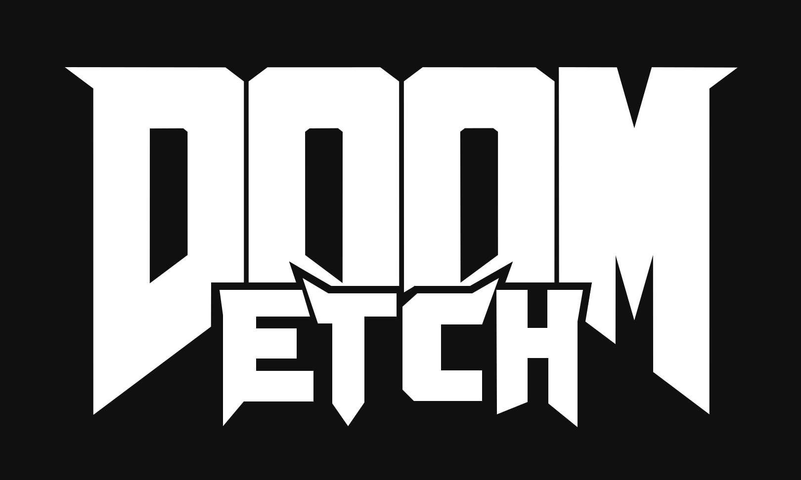

# doom-etch



DOOM drawing as one continuous line, like an Etch A Sketch.
Built from id Software's 1997 source release; see [LICENSE.TXT](LICENSE.TXT).

**Only tested on Apple Silicon Macs (macOS / Darwin, arm64).** The current native
build uses Apple's Clang, SDK, Metal and WebKit. Intel Macs are untested; Linux
and Windows builds are not provided.

## Dependencies

| Dependency | Needed for |
| --- | --- |
| Xcode Command Line Tools (Apple Clang, macOS SDK, Make and Git) | Building the native app and command-line tools. Full Xcode also works. |
| CMake **3.21+** | Configuring and building with the checked-in presets. |
| Python **3.9+** | The default `test` preset's CLI tests and the optional browser viewer server. Standard library only. |
| A local shareware **`doom1.wad`** | Playing DOOM, exporting game frames and running WAD-based tests. Game data is **not included** or downloaded by the build. |

Install the Command Line Tools if needed, then wait for the installer to finish:

```sh
xcode-select --install
```

If you use Homebrew, install the remaining build/test tools with:

```sh
brew install cmake python
```

Optional: **Node.js** (`brew install node`) enables the JavaScript viewer tests;
**FFmpeg** is only needed to encode the promo video. The rig model, textures,
three.js modules and their license are checked in. No `npm install`, SDL, separate
three.js download or web server is needed to play in the native app.

## Quick start: build and play

Clone and copy your existing shareware WAD into the ignored `test-data/` directory
(replace `/path/to/doom1.wad` with your file):

```sh
git clone https://github.com/tonysamaritano/DOOM-ETCH.git doom-etch
cd doom-etch
mkdir -p test-data
cp /path/to/doom1.wad test-data/doom1.wad
```

**From the repository root, these three commands build and launch the simulated rig:**

```sh
cmake --preset test -DDOOM_TEST_WAD_DIRECTORY="$PWD/test-data"
cmake --build --preset test --parallel
DOOMWADDIR=test-data ./build/test/doom-metal --play-on-etch -warp 1 1
```

Arrow keys move and turn, Control fires, Space opens doors, and Command-Q quits.
After building once, only the last command is needed to play again. All commands
below also run from the repository root.

For the conventional DOOM view, omit `--play-on-etch`:

```sh
DOOMWADDIR=test-data ./build/test/doom-metal -warp 1 1
```

## Verify the build

After the quick-start build:

```sh
ctest --preset test
```

`DOOM_TEST_WAD_DIRECTORY` configures WAD-based tests; `DOOMWADDIR` tells the running
game where to find its WAD. They serve separate purposes. Without a WAD you can
still configure with `cmake --preset test`, build, and run the synthetic-fixture
tests; WAD-based checks are omitted. With the WAD configured, `level-smoke` opens
a native window and plays 120 frames of E1M1. Node.js must be on `PATH` when
configuring to include the optional JavaScript tests.

To also exercise Metal drawing, standalone G-code playback and both live rig
modes, run from a logged-in macOS desktop session (these tests open windows):

```sh
cmake --preset test -DDOOM_TEST_WAD_DIRECTORY="$PWD/test-data" -DDOOM_ENABLE_GPU_TESTS=ON
cmake --build --preset test --parallel
ctest --preset test
```

Set `-DDOOM_ENABLE_GPU_TESTS=OFF` when reconfiguring to disable those extra checks.
For AddressSanitizer/UndefinedBehaviorSanitizer or LLVM coverage instrumentation,
replace `test` with `sanitize` or `coverage` in the configure, build and `ctest`
commands. Each preset has its own build directory; configure the WAD path for
each one. Coverage runs write `.profraw` files under `build/coverage/`.

Verification environment (2026-11-08): macOS **26.6.2 / arm64**, Apple Clang
**21.0.0**, CMake **4.2.3**, Python **3.14.3** for CTest / **3.11.5** for the viewer,
and Node.js **25.6.0**. Other platforms and older macOS versions have not been tested.

## Run a G-code frame

Export the settled E1M1 view, measure its physical playback, then open it without a WAD:

```sh
./build/test/etch-export test-data/doom1.wad /tmp/e1m1-00
./build/test/etch-gcode-run /tmp/e1m1-00.gcode --machine-readable
./build/test/doom-metal --etch-gcode /tmp/e1m1-00.gcode --etch-time-scale 1000
```

The runner reports completed moves, commanded steps and reversals per motor, and
simulated seconds, including any M0 shake. Calibration values are assumptions,
not measurements. For example, `--settings '$100=40' '$101=40'` changes steps/mm.
Commanded step counts exclude the simulator's separate backlash take-up.

The file window starts at 1× unless `--etch-time-scale` supplies a rate between
1/64× and 1024×. `+`/`=` doubles it and `-`/`_` halves it within those bounds.
F9 pauses, F6 replays from the start at the selected rate, and F7 interrupts
the file and shakes the drawing. An interrupted run does not report full-file
completion; use F6 to start again. Command-Q quits. Playback rate changes presentation only; reported simulated seconds and
motor counts retain their physical values. The rate option requires standalone
`--etch-gcode` mode.

## Play on the rig

After the quick start above, add `--fullscreen` to open the simulated rig fullscreen:

```sh
DOOMWADDIR=test-data ./build/test/doom-metal --play-on-etch --fullscreen -warp 1 1
```

The embedded local rig uses the full captured drawing, including the HUD, weapon,
sprites and hatching. It starts in instant visual mode. Ctrl-Command-F toggles
fullscreen; arrow keys move and turn, Control fires, Space uses doors, and Command-Q
quits. Sound effects use the Mac's audio output; music is not implemented.

F8 switches instant/timed drawing, +/- changes its presentation rate within
1/64×–1024×, F9 pauses the drawing and F7 erases it into a faint ghost.
F2 changes hatch pattern, F3 sprite hatching, F4 wall hatching, F5 sprites,
H the HUD, G the gun and J gun hatching. Layer changes clear the visual ghost.

Add `--etch-via-gcode` to drive one persistent simulated device through the actual
G-code writer, parser and step compiler. Ink, knobs, motors and belts follow the
same physical state, including backlash. This option advances at physical **1×**;
the game stays responsive while the current drawing and its shake finish.
F9 pauses physical drawing without catch-up. F7 or a layer change finishes the
current segment, cancels the rest and requests the existing physical shake.
F8 and +/- do not accelerate this mode; its badge and title identify physical 1×.
Physical mode rejects `--etch-gpu-rate` and `--etch-gpu-instant` at startup.
`--etch-time-scale` remains restricted to standalone `--etch-gcode FILE` playback.
Calibration is assumed: 20 steps/mm, 60 mm/s and 250 mm/s² per axis,
0.15 mm backlash, 20 mm per knob turn, and a 2.5-second shake retaining 3% of marks.
The physical clock reports simulated duration under those assumptions.

Each build refreshes an `etch-play/` resource directory beside `doom-metal`, including
the model, both note textures, required three.js modules and their MIT license.
Keep that directory with the executable when moving it. The local custom URL scheme
needs no web server, bundler, internet connection or working-directory-specific assets.
The visible model opening is 178.4 × 127.6 mm; the drawing covers it edge to edge.
Physical travel and all controller calculations stay at 170.15 × 127.6 mm.

## Measure the required drawing speed

Request drawing demands at a target frame rate alongside the physical result:

```sh
./build/test/etch-export test-data/doom1.wad /tmp/e1m1 --target-fps 30
./build/test/etch-gcode-run /tmp/e1m1.gcode --target-fps 30 --machine-readable --trace /tmp/e1m1.json
./build/test/etch-gcode-run /tmp/e1m1.gcode --target-fps 35
```

Both tools print these demands only with `--target-fps`. Their existing default
output stays unchanged. Trace JSON always includes a `requirements` array at the requested
fps, or 30 fps when omitted. Frame IDs start at zero and preserve empty M0 frames.
Each frame gets its own drawing-only 1/fps budget, retaining its starting cursor.
Target fps affects reporting only; commands, step counts and physical clocks retain
their values. The existing PATH line remains the raw, unquantized ideal-feed estimate.

For commanded segment distances in metres, length L and sum S of square roots,
no-stop speed is L×fps and stop-at-every-vertex acceleration is (2×S×fps)².
Peak speed is √(acceleration×longest segment). Mach uses an assumed 343 m/s;
g uses standard gravity 9.80665 m/s². Knob RPM is a path-speed-equivalent demand
using the assumed mm per knob turn; separate-axis and motor-pulley speeds differ.
Backlash, shake and jerk are excluded from this drawing-demand calculation.
A 100 mm straight line at 30 fps requires 3 m/s without stops, or 360 m/s²
and 6 m/s peak with stops, equivalent to 9,000 knob rpm at 20 mm per turn.
Nonfinite rates and unrepresentable positive demands fail with a diagnostic.

## Render the eighteen-second pitch

After building and adding `test-data/doom1.wad`, generate the current E1M1 physical
trace and start the local viewer server. Python 3.9+ and a WebGL-capable browser
are required; the necessary three.js 0.163.0 modules are already bundled:

```sh
tools/rig_frame.sh
python3 viewer/capture_server.py
```

Open [the looping pitch](http://127.0.0.1:8770/viewer/index.html?promo=pitch)
while the server is running. See [viewer/README.md](viewer/README.md) for ordinary
trace playback.
Add `&promoAt=16.5` to hold a moment; values from 0 through 18 are video seconds.
The pitch requires one completed, nonempty frame with its actual 30 fps requirements.
It uses the trace's assumed calibration and physical time. The drive close-up samples
a recorded interval at 1×; the other shots show the completed drawing.

Open [pitch capture](http://127.0.0.1:8770/viewer/index.html?promo=pitch&capture) to write exactly
540 JPEGs at 1920×1080, sampling video times 0 through 539/30. Starting a capture
replaces only its numbered `00000.jpg` through `00539.jpg` files; unrelated files
remain. Each frame must be acknowledged before the next is rendered. Capture errors
appear in the viewer; a failed run cannot report completion. After all 540 frames
finish, encode with FFmpeg (`brew install ffmpeg` if using Homebrew):

```sh
ffmpeg -framerate 30 -i build/promo/pitch/frames/%05d.jpg -c:v libx264 -pix_fmt yuv420p -crf 16 build/promo/pitch/etch-pitch.mp4
```

The server binds to loopback and accepts only the pitch capture route. Its JPEG
checks validate headers and dimensions; decoding all frames during encoding is
the image-data check. The finished pitch keeps the toy assembled and the drawing
visible, with a shared price/burst tilt, a pulse and the hardware-not-built fine print.

## Source map

- `engine/core/`: startup, shared types, utilities, memory and I_* interfaces.
- `engine/game/`: gameplay, physics, maps and savegames.
- `engine/render/`: software rendering, video operations and wipes.
- `engine/ui/`: menus, automap, HUD, status bar, intermission and finale.
- `engine/sound/`: engine sound management and sound definitions.
- `engine/wad/`: WAD loading and resource caching.

Platform, test and drawing code:

- `platform/darwin/`: native macOS window, Metal, input, sound and main.
- `etch/`: continuous motion paths, silhouettes, hatching and output writers.
- `machine/`: G-code, steppers, physical simulation and requirements.
- `viewer/`: browser rig viewer and promo.
- `tools/`: capture, export and G-code command-line tools.
- `tests/`: automated checks.
- `assets/doom-etch.svg`: editable DOOM ETCH wordmark, copied unchanged from
  `episode-1-etch-doom/video/assets/doom-etch.svg`. Hide its `background` layer
  for a transparent export.
- `assets/rig/`: the rig model and note textures.
- `test-data/`: ignored local shareware `doom1.wad`; game data is not included.
